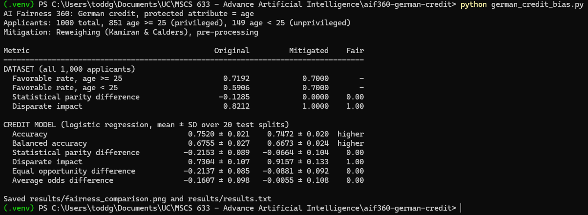
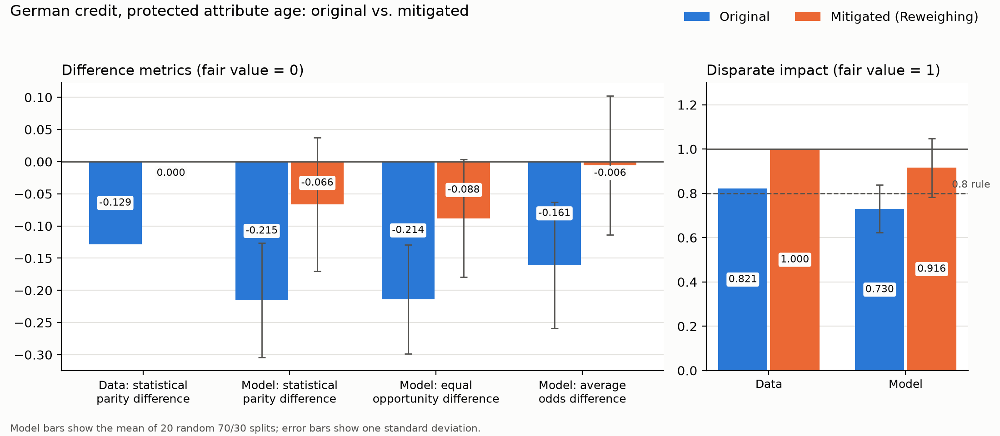

# Bias Detection and Mitigation on German Credit Data with AI Fairness 360

Measures age bias in the German credit dataset with IBM's [AI Fairness 360](https://github.com/Trusted-AI/AIF360) (AIF360) toolkit, then mitigates it with the Reweighing algorithm. A logistic regression credit model is trained on the original data and on the reweighed data, and the two are compared on accuracy and group fairness.

## Dataset

[UCI Statlog (German Credit Data)](https://archive.ics.uci.edu/dataset/144/statlog+german+credit+data), file `german.data`, included in `data/`. It holds 1,000 loan applicants, each labeled as a good or bad credit risk, with 20 attributes such as checking account status, credit history, loan duration, and age.

AIF360 reads this file only from its own install folder, so the script copies `data/german.data` there on the first run. If the project copy is missing, the script downloads it from UCI.

## Protected attribute and groups

- **Protected attribute:** age
- **Privileged group:** applicants 25 and older (851 applicants)
- **Unprivileged group:** applicants under 25 (149 applicants)
- **Favorable outcome:** classified as a good credit risk

The age 25 boundary follows IBM's AIF360 credit scoring tutorial. `sex` and `personal_status` are dropped so the analysis isolates age.

## Requirements

- Python 3.11 to 3.14
- The packages in `requirements.txt`

## Setup and run

```powershell
python -m venv .venv
.venv\Scripts\Activate.ps1          # macOS/Linux: source .venv/bin/activate
pip install -r requirements.txt
python german_credit_bias.py
```

## How it works

1. **Measure dataset bias.** Favorable rates for each age group, statistical parity difference, and disparate impact are computed on the labels of all 1,000 applicants.
2. **Mitigate with Reweighing.** Reweighing (Kamiran & Calders, 2012) assigns each combination of group and label a weight so that age and the favorable label become statistically independent in the training data. No records or labels are changed.
3. **Train and compare models.** A logistic regression model is trained on the original training data and again with the Reweighing weights. Reweighing is fit on the training split only.
4. **Average over splits.** The unprivileged group is small, so one split gives noisy fairness numbers. Model metrics are averaged over 20 random 70/30 splits and reported as mean ± standard deviation.

## Metrics

| Metric | Fair value | Meaning |
| --- | --- | --- |
| Statistical parity difference | 0 | Favorable rate of the unprivileged group minus the privileged group |
| Disparate impact | 1 | Ratio of those favorable rates; below 0.8 fails the four-fifths rule |
| Equal opportunity difference | 0 | Difference in true positive rates between groups |
| Average odds difference | 0 | Mean of the differences in false positive and true positive rates |

## Output

The script prints the comparison and saves it to `results/`:

| File | Contents |
| --- | --- |
| `results.txt` | Original vs. mitigated metrics as plain text |
| `fairness_comparison.png` | Chart of original vs. mitigated fairness metrics |

## Screenshot




